<div align="center">


# NEXUS

**Network EXperimentation Unified System: draw a wired, wireless or SDN topology in the browser, start it as a real Mininet, Mininet-WiFi or Containernet emulation, and operate it from one web console.**

*One canvas, one Start button, one console: design, emulate, run commands, watch traffic, run distributed algorithms and talk to the network through an MCP-backed AI console.*


[Quick start](#quick-start) · [Screenshots](#screenshots) · [Containers](#containers) · [Example topologies](#example-topologies) · [Architecture](#architecture) · [Known limitations](#known-limitations) · [System architecture](docs/paper/SYSTEM_ARCHITECTURE.md) · [Project overview](docs/PROJECT_OVERVIEW.md)

</div>

NEXUS is a network emulation platform built as a set of microservices around a per-topology emulation
container. You place hosts, switches, routers, access points, stations, P4 switches and SDN controllers
on a canvas, set their properties (IP, SSID, Wi-Fi mode, mobility, link bandwidth, delay, loss, jitter)
and press Start. The orchestrator then starts a privileged container for that topology that runs
Mininet, Mininet-WiFi and Containernet, builds the network inside it and streams its state back to the
browser. From the same page you open a Mininet CLI, a shell on any node, live telemetry, a distributed
algorithm runner, MANO and OSM views, the web UIs of containers and infrastructure services, and an AI
console whose tools are exposed through the Model Context Protocol (MCP).

The project was formerly called Caduceus-Flux. Some container names and identifiers still carry that
name (see [Known limitations](#known-limitations)).

<div align="center">
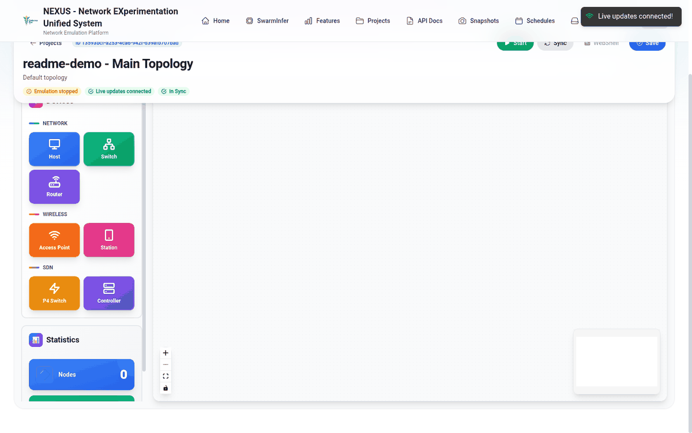
<br><sub>Building a Wi-Fi topology: add an access point and four stations, link them, set SSID, channel and IPs, save.</sub>
</div>

## What it does

| | |
| --- | --- |
| **Topology designer** | React Flow canvas with seven node types in three groups: Host, Switch, Router (network), Access Point, Station (wireless), P4 Switch, Controller (SDN). Per-node property tabs (General, Wireless, Mobility, Docker) and per-link bandwidth, delay, packet loss and jitter. Projects hold several topologies, with JSON import and export. |
| **One container per topology** | Start asks the orchestrator to create a privileged emulation container for that topology from the image built in `emulation-container/` (Mininet-WiFi, Containernet and Open vSwitch; the full `Dockerfile` also adds hostapd and BMv2). The container exposes a gRPC agent; Stop removes it again. |
| **Network Manager** | One page per running topology with 18 tabs: Overview, Network Monitoring, MANO, Hosts, Switches, Routers, Controllers, Mininet CLI, Test Network Topology, Configuration, Algorithms, Export Script, Web Shell, Diagnostics, Container UI, AI Console, ML Models and Data Lab. |
| **Mininet CLI and Web Shell** | A browser terminal attached to the Mininet CLI of the running network, and a WebSocket shell into any single node (`webshell-service`). |
| **Telemetry** | Device telemetry (CPU, memory, RX/TX) and live traffic charts from `monitoring-service`; metrics flow through `metrics-collector-service` into Kafka and InfluxDB, with Prometheus and Grafana alongside. Diagnostics queries InfluxDB with filters and shows charts and a summary table. |
| **Distributed algorithms** | The Algorithms tab runs message-passing algorithm templates (for example a distributed maximal independent set with HELLO/ACK neighbour discovery) on the emulated nodes over UDP, with live counters, a message trace, run history and validation checks. |
| **SDN and P4** | Controller nodes for ONOS, Ryu, OS-Ken and OpenDaylight through `controller-manager-service`; P4 programs are uploaded and compiled by `p4-manager-service` and assigned to BMv2 `p4switch` nodes. |
| **MANO and OSM** | `mano-service` (local MANO core, gRPC on 50052), `osm-connector-service` (ETSI SOL005/NBI adapter) and an optional OSM stack in the compose file. |
| **AI console over MCP** | `ai-gateway-service` routes chat to Ollama, OpenAI, Anthropic or Gemini (keys are entered in AI Settings) and to specialised agents (admin, diagnostics, emulation_ops, infra_ops, mcp_ops, network_config, snapshots). It exposes 47 MCP capabilities over the platform; `mcp-tool-hub-service` and the `mcp` compose profile add MCP servers for Grafana, InfluxDB, Kafka, Prometheus, RabbitMQ, Flink, Spark, HDFS, Hive and ONOS. |
| **Snapshots, schedules, data** | Snapshot and schedule pages per topology, an API docs page, ML model and Data Lab pages, and a JupyterLab, Spark, Flink, HDFS and Hive data stack in the compose file. |

## Screenshots

The screenshots were taken from the real interface (English UI, light and dark theme) with Playwright.
The live screenshots come from the `demo-wifi-4sta` example below while its emulation was running on
a single host; the values in them (signal, ping, counters) are a demonstration of the interface, not
measurements. They were captured from a development build whose navigation bar has one extra entry
(SwarmInfer) that is not on `main`, and whose header still shows the old logo.

<div align="center">
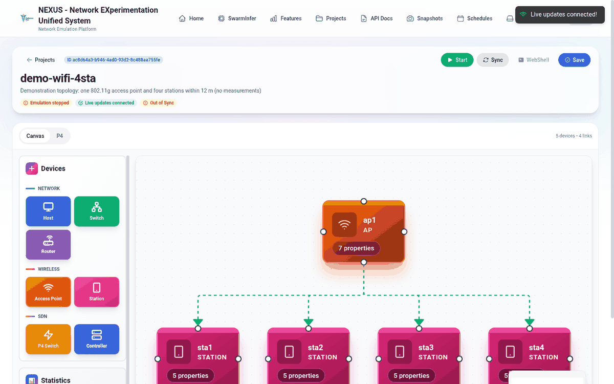
<br><sub>Start a topology, then the Network Manager: overview, signal, pingall, ping, monitoring, diagnostics and the algorithm runner.</sub>
</div>

### Design

| | |
| --- | --- |
| 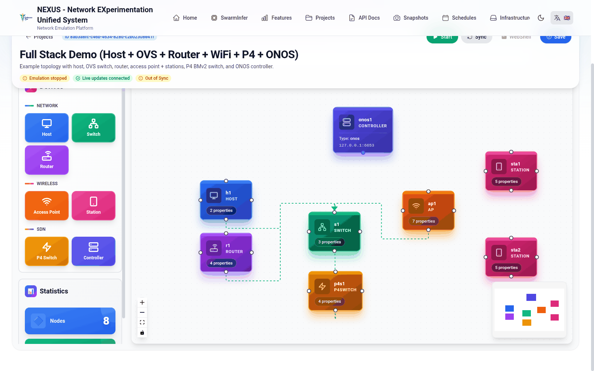<br><sub>Designer with the bundled full-stack example: host, OVS switch, router, access point, stations, P4 switch and ONOS controller.</sub> | 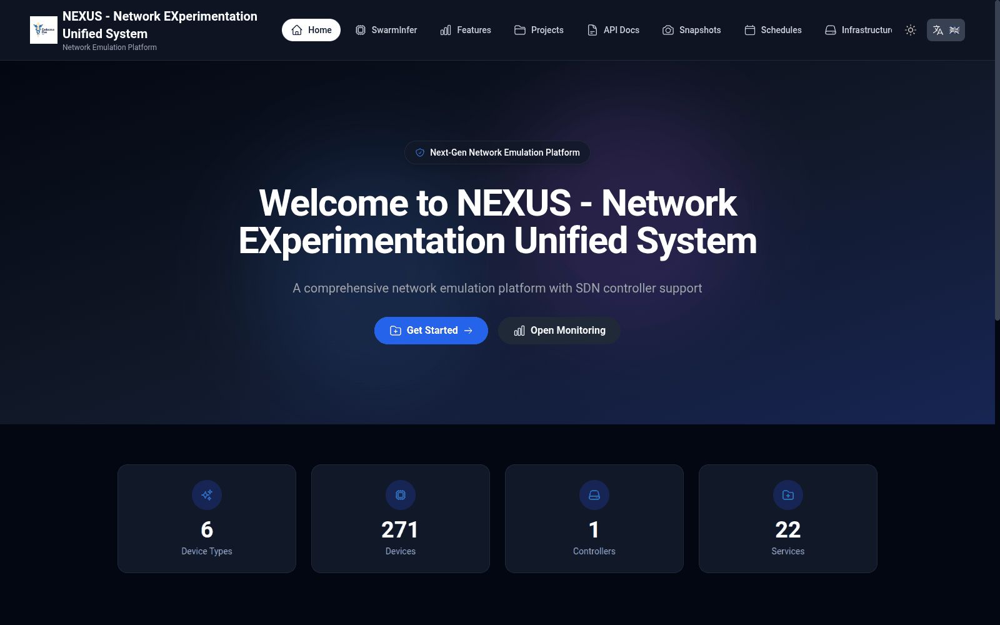<br><sub>Home page with counters read from the running backend.</sub> |
| 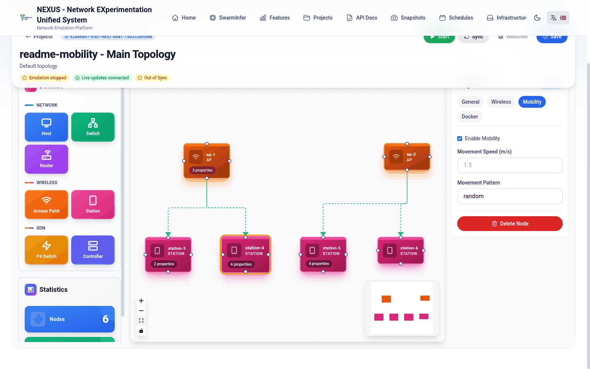<br><sub>Two access points and four stations; the Mobility tab of a station sets speed and movement pattern.</sub> | 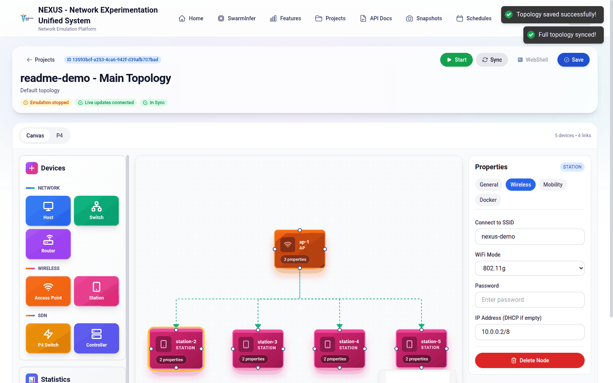<br><sub>Station properties: SSID, Wi-Fi mode, password and IP address.</sub> |
| 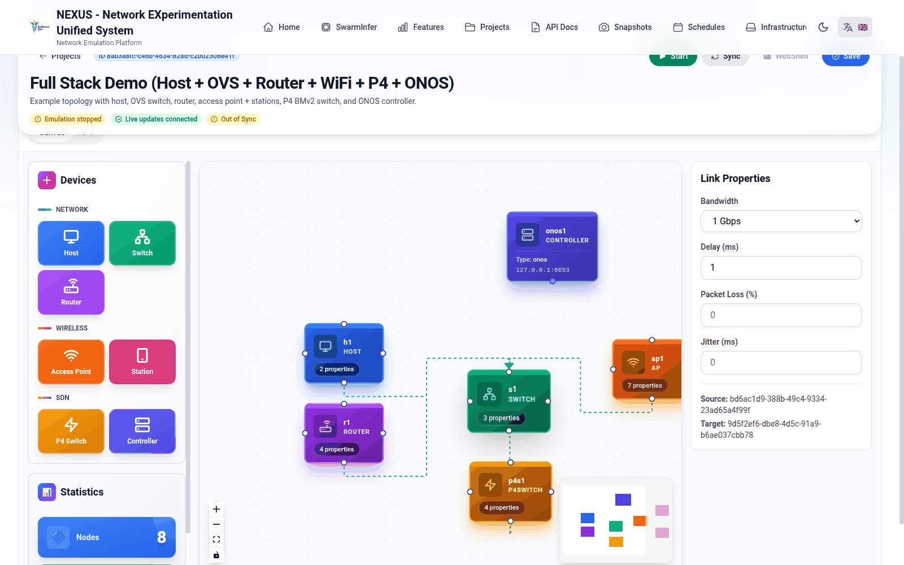<br><sub>Link properties: bandwidth, delay, packet loss and jitter.</sub> | 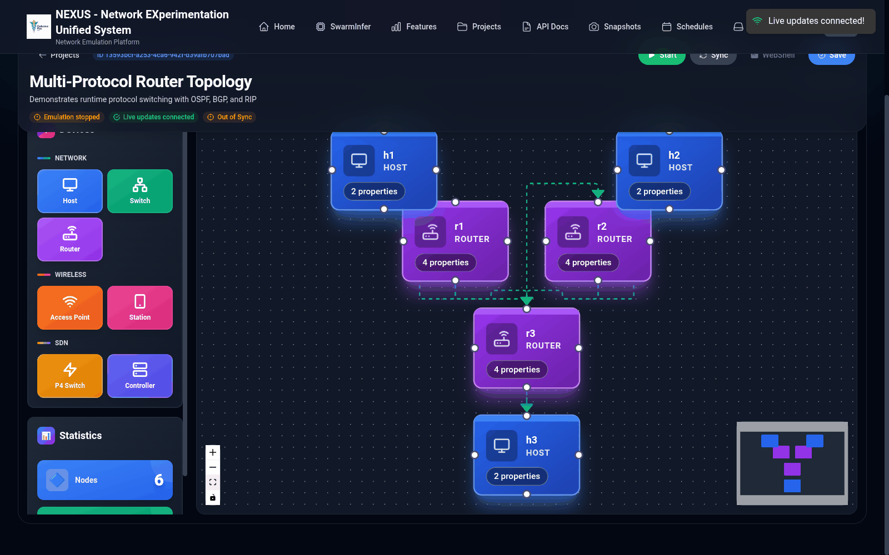<br><sub>The bundled multi-protocol router example (OSPF, BGP, RIP) in the dark theme.</sub> |

### Running emulation

| | |
| --- | --- |
| 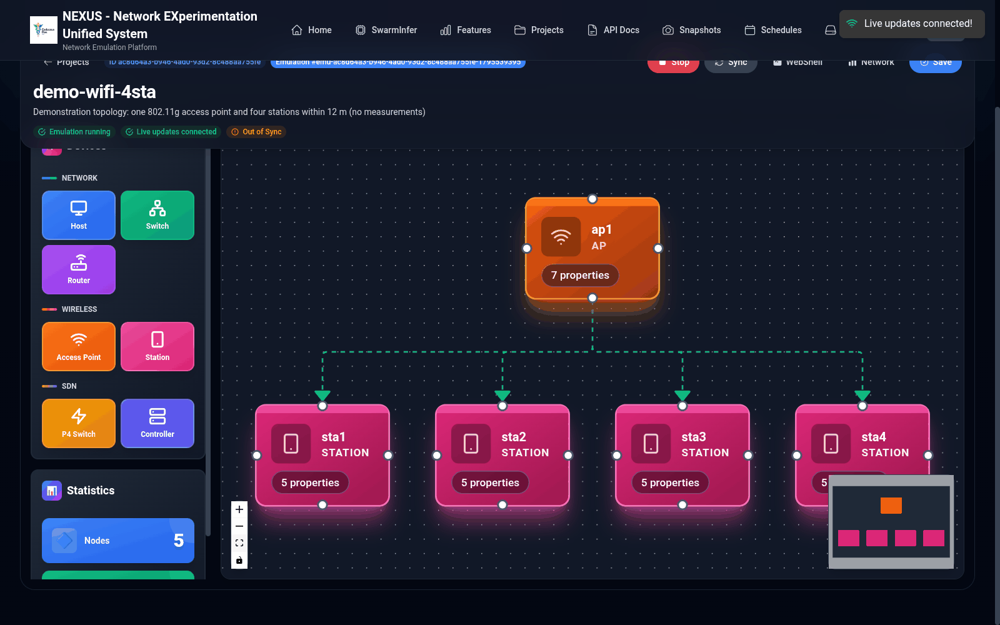<br><sub>A running Wi-Fi topology: "Emulation running" badge and the Stop button.</sub> | 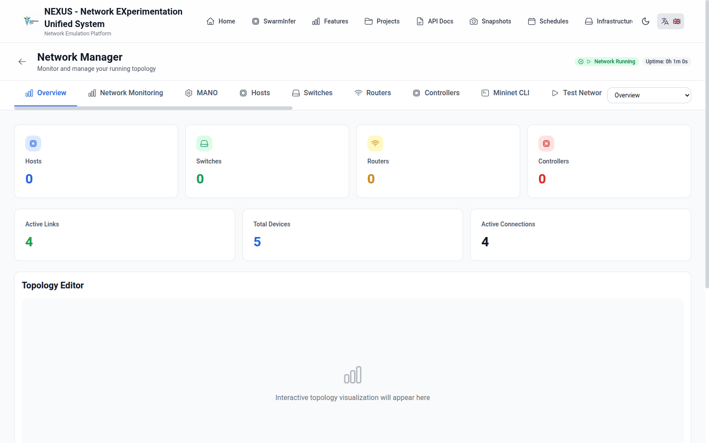<br><sub>Network Manager overview with uptime and active links.</sub> |
| 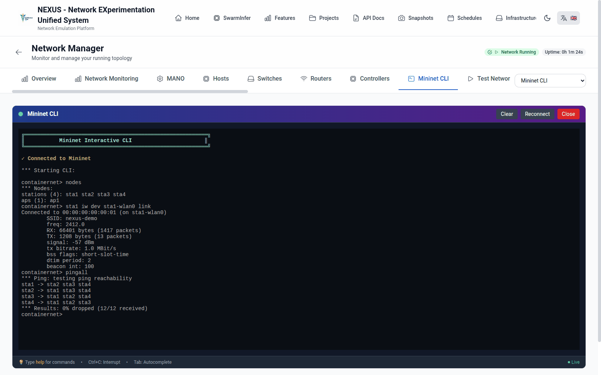<br><sub>Mininet CLI in the browser: <code>nodes</code>, <code>iw dev ... link</code> and <code>pingall</code>.</sub> | 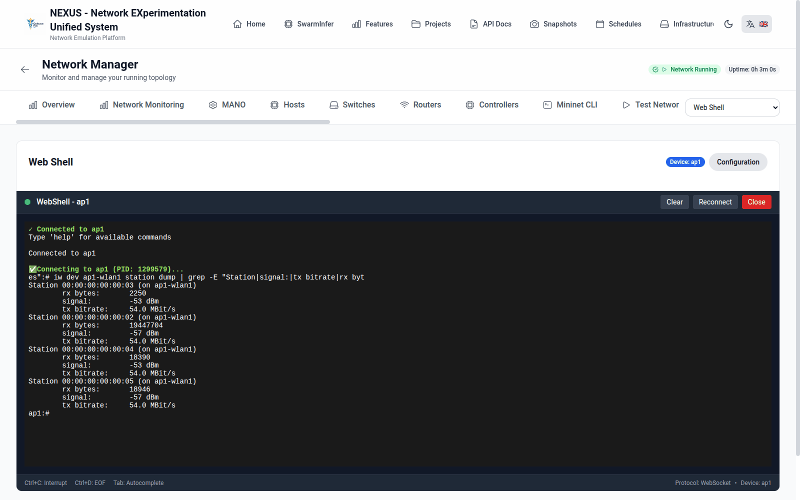<br><sub>Web Shell on the access point: <code>iw dev ap1-wlan1 station dump</code> lists the four stations.</sub> |
| 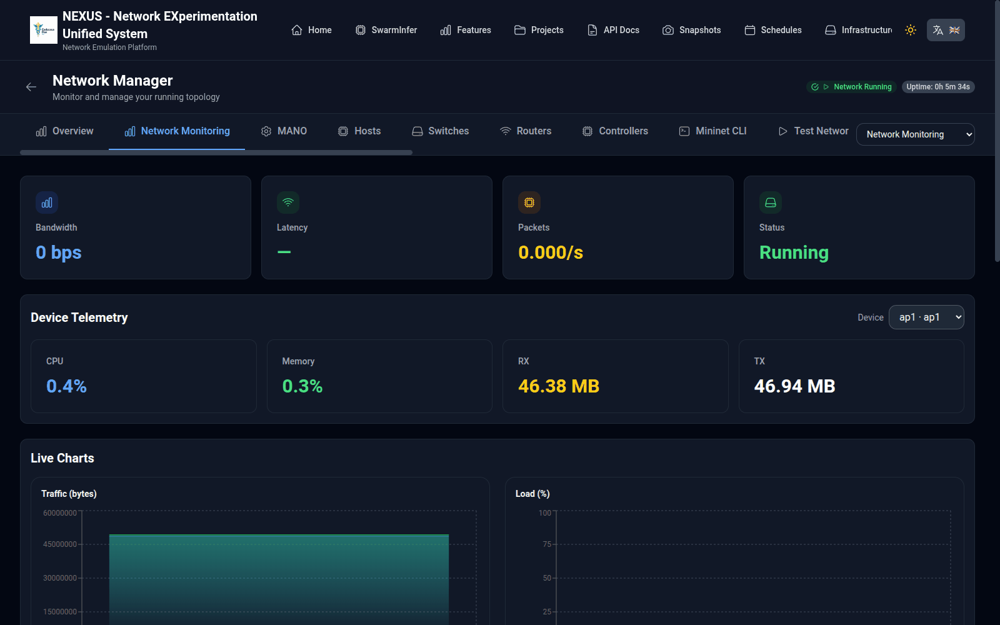<br><sub>Network Monitoring: device telemetry and live traffic chart while background <code>iperf</code> traffic runs.</sub> | 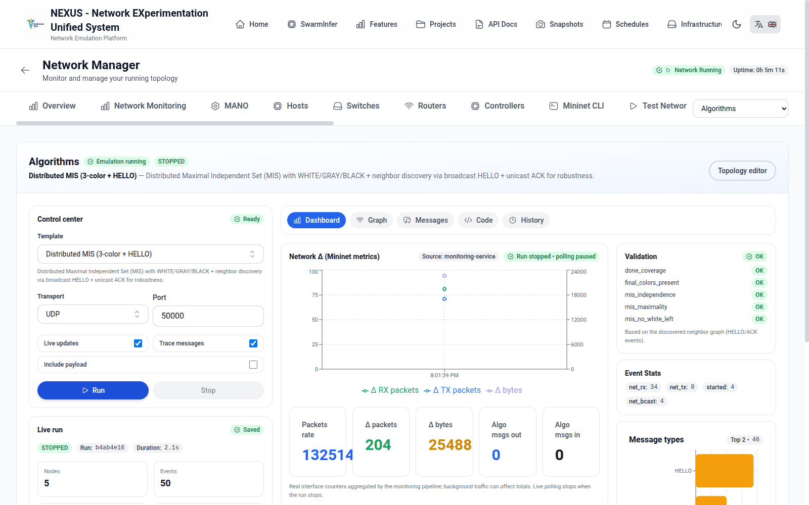<br><sub>Algorithms: a finished distributed MIS run with its validation checks.</sub> |
| 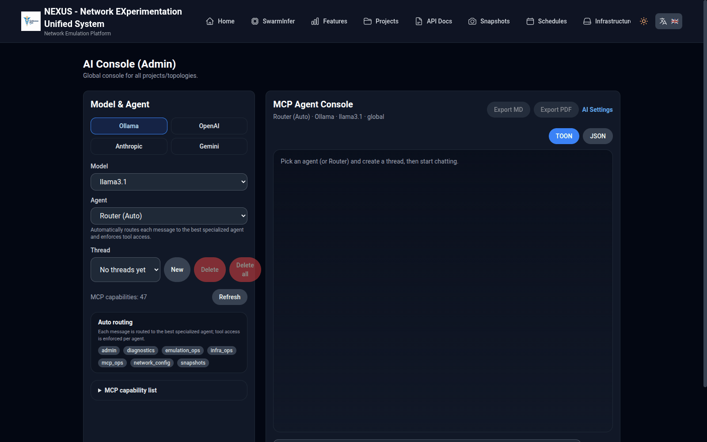<br><sub>AI Console: provider, model and agent selection, the 47 MCP capabilities and the auto-routing agents.</sub> | |

## Quick start

NEXUS needs a Linux host with Docker and Docker Compose v2. The emulation container runs privileged
(Mininet and Mininet-WiFi create network namespaces and virtual radios), and the full compose file
starts a large stack, so plan for a machine with plenty of memory and disk. These commands are the
ones the repository uses; they were not re-run for this README.

```bash
git clone https://github.com/egerberkuslu/nexus.git
cd nexus

# 1. Settings. Compose reads ports and credentials from .env; change every default password.
cp env.example .env

# 2. Emulation image that the orchestrator starts for each topology
(cd emulation-container && docker build -f Dockerfile.simple -t caduceus-flux-emulation-container:latest .)

# 3. Platform
docker compose up -d --build

# Optional: MCP servers for Grafana, InfluxDB, Kafka, Prometheus, RabbitMQ, Flink, Spark, HDFS, Hive, ONOS
docker compose --profile mcp up -d
```

Then open the web interface at `http://localhost:3000` (`FRONTEND_PORT`). Grafana listens on
`http://localhost:3001` and the Swagger index of all services is served through Nginx at
`http://localhost/api/docs`. To try the platform, go to Projects, choose Import Topology, load
`examples/demo-wifi-4sta.json`, open it and press Start.

`docker-manage.sh` and `start-services.sh` wrap the same compose commands. The smoke tests in
`scripts/` (`sdn_smoke_test.sh`, `mano_smoke_test.sh`, `mcp_tool_hub_smoke_test.sh`,
`verify_ai_ml_features.sh`) check a running stack.

## Containers

The Container UI tab of the Network Manager embeds web interfaces without leaving NEXUS. In
Emulation Node mode it opens a web port of a node inside the running topology. In Infrastructure mode it
opens the shared services (Grafana, Prometheus, Consul, InfluxDB, pgAdmin, Mongo Express, RabbitMQ,
Kafka UI, Flink, Spark, HDFS, Hive, Hue), the OSM NG-UI and Light UI, and the UI of a per-topology SDN
controller. Services that forbid framing are offered in a new tab instead.

## Example topologies

All examples live in [`examples/`](examples). Import one from the Projects page with Import Topology,
pick the JSON file and a target project. When a project is selected the dialog ticks "Overwrite an
existing topology" by default; untick it if the project already holds a topology you want to keep.

| File | What it is |
| --- | --- |
| [`demo-wifi-4sta.json`](examples/demo-wifi-4sta.json) | One 802.11g access point (SSID `nexus-demo`, channel 1, open) and four stations `10.0.0.1-4/8`, all within 12 m. Every node carries an explicit `position`, which the wireless medium needs for the stations to associate. This is the topology behind the live screenshots and the second GIF. |
| [`demo-roaming-2ap.json`](examples/demo-roaming-2ap.json) | Two access points 40 m apart that share the SSID `nexus-roam` on channels 1 and 6, with one station near each and one between the cells. A starting point for roaming experiments: enable Mobility on a station in its property panel. It was saved as a design and has not been started. |
| [`full-stack-demo-onos-p4-wifi.json`](examples/full-stack-demo-onos-p4-wifi.json) | SDN example: host, OVS switch, router, access point with two stations, BMv2 P4 switch and an ONOS controller. Its Wi-Fi password is a sample value from the old project name; replace it before use. |
| [`multi-protocol-router.json`](examples/multi-protocol-router.json) | Three routers (OSPF, BGP, RIP) and three hosts. |
| [`simple-topology.json`](examples/simple-topology.json), [`wireless-mesh.json`](examples/wireless-mesh.json), [`localai-p2p-cluster-single-switch.json`](examples/localai-p2p-cluster-single-switch.json) | Two hosts and a switch; one access point with three 802.11ac stations; a Containernet cluster of one OVS switch, one LocalAI master and three dockerized LocalAI workers (see [`LOCALAI_CLUSTER_GUIDE.md`](examples/LOCALAI_CLUSTER_GUIDE.md)). |

The two `demo-*` files contain no passwords or keys.

## Architecture

```
Browser (React 18 + Vite, React Flow, xterm.js)
   │  HTTP / WebSocket via Nginx (:80)
   ▼
Control plane: FastAPI microservices (8001-8020)
   topology · orchestrator · protocol-manager · device-manager · controller-manager
   snapshot · webshell · export-import · topology-generator · p4-manager · monitoring
   mcp-server · metrics-collector · ai-gateway · mano · config · decision-engine
   mcp-tool-hub · osm-connector
   │  gRPC (:50051)                        │  Kafka · InfluxDB · Prometheus
   ▼                                        ▼
Per-topology emulation container       Data and observability stack
   Mininet · Mininet-WiFi · Containernet   PostgreSQL · MongoDB · Redis · RabbitMQ · Consul
   Open vSwitch · wmediumd · hostapd       Grafana · Flink · Spark · HDFS · Hive · JupyterLab
   BMv2
   │
SDN controllers (ONOS, Ryu, OS-Ken, OpenDaylight) and the optional OSM stack
```

| Path | Contents |
| --- | --- |
| `frontend/` | Web interface; pages in `frontend/src/pages`, designer in `frontend/src/components/TopologyDesigner.tsx`. |
| `backend/services/` | The 21 FastAPI services, one folder each. |
| `emulation-container/` | Dockerfiles and gRPC agent of the per-topology emulation container. |
| `controllers/` | Ryu and OS-Ken controller images. |
| `infrastructure/` | Nginx, Grafana, Kafka Connect, Flink, Hive, Hue, Jupyter, OSM and MCP configuration. |
| `examples/` | Example topologies, algorithm and network configuration samples. |
| `docs/` | Architecture, API, MANO, OSM, control configuration and troubleshooting notes. |

Further reading: [system architecture](docs/paper/SYSTEM_ARCHITECTURE.md),
[project overview](docs/PROJECT_OVERVIEW.md), [API](docs/API.md),
[control configuration](docs/CONTROL_CONFIG.md), [MANO](docs/MANO_FEATURES.md),
[OSM integration](docs/OSM_INTEGRATION.md), [AI/ML streaming control plane](docs/AI_ML_STREAMING_CONTROL_PLANE.md),
[metrics pipeline](METRICS_PIPELINE.md), [troubleshooting](docs/TROUBLESHOOTING.md).

## Known limitations

These were observed while preparing this README and are not fixed yet.

- **Export of wireless topologies.** The script produced by the Export Script tab for a topology with
  access points and stations contained no `addAccessPoint` or `addStation` calls, while its
  `net.addLink(...)` lines referred to those undefined nodes, so it did not run. Wired topologies are
  not affected. The script header still reads "Generated by Caduceus-Flux".
- **Station position.** The property panel has no position field. With the wmediumd interference
  model, stations without a position did not associate ("Stations still unassociated after 30.0s").
  Set `position` in the topology JSON, as the `demo-*` examples do.
- **Import overwrites by default** when a target project is selected (see
  [Example topologies](#example-topologies)).
- **The `/monitoring/<id>` page crashed** with `TypeError: n.toFixed is not a function`, also while an
  emulation was running. Use the Network Monitoring tab of the Network Manager instead.
- **Diagnostics chart.** The x-axis timestamps of the Diagnostics chart were not in order.
- **Side containers.** Opening the Network Manager or MANO tab of a topology that has a controller can
  start a per-topology ONOS controller and an isolated OSM stack (`OSM_AUTO_BOOTSTRAP_ISOLATED`
  defaults to `true` in the orchestrator). Set it to `false` if you do not want them.
- **Default credentials.** The compose defaults for Grafana, InfluxDB and the databases are placeholders
  and the Test Network Topology tab displays them; set your own in `.env` before exposing the stack.
- **`quick-start.sh`** copies `.env.example`, but the template in the repository is `env.example`.
- **Old name.** Container names (`caduceus-*`), the emulation image name, the InfluxDB organisation,
  Consul keys, the frontend package name, the logo in the web interface (`frontend/public/logo2.png`)
  and several files in `docs/` still use Caduceus-Flux.
- **No license file** is in the repository yet.
